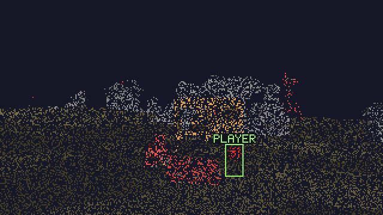

# Rust CCTV recorder

## Disclosure: Don't expect the real gameplay footage. The data is reconstructed with a custom written renderer.



Local recorder: one Rust+ connection, one case-sensitive camera ID, PNG frames piped directly into one FFmpeg process per recording session, and timestamped H.264 MP4 segments. Defaults: 10 FPS, 2x render scale, 15-minute segments, `libx264` ultrafast, CRF 18, two encoder threads. No temporary PNG sequence is written.

## Readable camera rendering

The recorder now uses its own renderer. Surface shading retains an ambient brightness floor, so zero-alignment rays no longer turn the ground and other surfaces completely black. Material colours are chosen for readability; they are not game textures or a verified reproduction of the official app's shader. No-hit rays and areas without recent samples use a dark background.

Samples accumulate long enough to cover a full refresh of the camera's native pixel grid. `SampleLifetimeSeconds` sets a minimum (three seconds by default); the renderer extends it to 1.5 times the estimated refresh period for sparse feeds, capped at 30 seconds. Samples fade only during the last quarter of that interval and eventually expire if the feed stops. Longer retention can leave longer trails behind moving objects. Physical camera movement or zoom clears the old projection; changes in the ray-sampling rotation do not. Rust added [server-side raycast jitter](https://commits.facepunch.com/610661), which must not be mistaken for physical camera movement.

Player markers and server-provided names use the latest packet's metadata and expire after 0.75 seconds without an update. Names currently use portable uppercase ASCII lettering; unsupported characters display `?`. Markers indicate the reported position and size, not an exact silhouette or team membership.

For a 320x180 camera, the default output is 640x360 at 10 FPS. Scaling preserves the source samples and makes labels easier to read; it does not create additional camera detail. Higher recording FPS samples incoming updates more often, but cannot increase the server's update rate. CRF 18 reduces compression loss compared with the previous CRF 25 setting. Pi performance still needs a live check; lower `Fps` or `RenderScale` if the encoder cannot keep up.

These changes apply to new recordings. An existing MP4 does not contain the raw depths, materials, and entity metadata needed to render it again.

## Project state and package verification

The supplied Windows workspace was empty. The existing Raspberry Pi snapshot project was **not available for inspection or modification**. This is a new recorder project; keep your working snapshot project as a backup until live Pi recording has passed the checks below. `--snapshot` provides the same single-PNG capture workflow described in the request.

The target remains `net8.0`. Both Rust packages are pinned to exactly `2.0.0-beta.9` with NuGet version ranges and `packages.lock.json`. Their restored NuGet metadata points to commit `3b45e28edbdd81a077c01784b5707febc4832dc9`, identical to `v2.0.0-beta.9`. The netstandard2.0 assemblies were used for compilation. Signatures were checked against their XML metadata and that exact source revision:

- [CameraController source](https://github.com/HandyS11/RustPlusApi/blob/3b45e28edbdd81a077c01784b5707febc4832dc9/src/RustPlusApi.Camera/CameraController.cs): `SubscribeAsync`, `OnFrameReceived`, `OnKeepAliveFailed`, and asynchronous disposal. Default renewal is every 10 seconds.
- [Reference camera decoder](https://github.com/HandyS11/RustPlusApi/blob/3b45e28edbdd81a077c01784b5707febc4832dc9/src/RustPlusApi.Camera/CameraRenderer.cs): the local `Rendering/` implementation preserves its sample shuffle and wire format, fixes a skipped final one-byte ray, and replaces its shading/accumulation. See `THIRD_PARTY_NOTICES.txt`.

No systemd unit, events, dashboard, notifications, retention deletion, or additional cameras are implemented yet. Recordings accumulate until you remove them.

## Run on the Pi

Use a separate checkout beside the proven snapshot project initially. Run commands from this project's directory. Requirements are .NET 8 SDK and FFmpeg with `libx264` available on `PATH`.

```bash
dotnet --list-sdks
ffmpeg -hide_banner -encoders | grep libx264
dotnet restore --locked-mode
dotnet build --no-restore
```

Set the non-secret settings in `appsettings.json`, under `Recorder`. Set `CameraId` to the exact camera identifier, or use the existing `RUST_CAMERA_ID` variable. It takes precedence over the JSON setting. Keep the existing credentials in environment variables:

```text
RUST_SERVER         Rust server hostname or IP
RUST_PORT           Rust+ companion port (not the game port)
RUST_PLAYER_ID      Steam ID, unsigned 64-bit integer
RUST_PLAYER_TOKEN   Pairing token, signed 32-bit integer
RUST_CAMERA_ID      Optional camera override; case-sensitive
```

Load these through your existing private environment setup. Do not put a real token in the JSON, a shell script tracked by Git, or a command-line argument. The application reads credentials only from the environment and does not log them. Raw Rust+ protocol logging is disabled.

```bash
# Same snapshot workflow, writing ./snapshot.png after 15 seconds of accumulation:
dotnet run -- --snapshot

# Continuous recording; Ctrl+C closes stdin and waits for the MP4 trailer:
dotnet run
```

The app logs connection, first rays, encoder start, each finalized segment, reconnection, and shutdown. It does not log each frame. If the camera produces no first frame, the operation times out. Snapshot mode exits with a nonzero code on failure; continuous mode retries transient session failures.

Generic Host's console lifetime handles Ctrl+C/SIGINT and SIGTERM. For daemon-style signal checks, signal the actual application process:

```bash
dotnet bin/Debug/net8.0/RustCctv.dll &
recorder_pid=$!
# Allow at least a few seconds of recording, then:
kill -TERM "$recorder_pid"
wait "$recorder_pid"
```

## Configuration

Environment overrides use .NET's double underscore separator, for example `Recorder__Fps=2` or `Recorder__OutputDirectory=/mnt/cctv`. Command-line overrides also work: `dotnet run -- --Recorder:SegmentMinutes=1`.

| Setting | Default | Allowed range / meaning |
|---|---:|---|
| `CameraId` | empty | Required; exact identifier, at most 256 characters |
| `OutputDirectory` | `recordings` | Relative to the current working directory, or absolute |
| `Fps` | 10 | Integer 1–30; reduce if the Pi cannot keep up |
| `RenderScale` | 2 | Integer 1–4; multiplies native dimensions, without adding source detail |
| `SampleLifetimeSeconds` | 3 | 0.25–30; minimum retention, extended for sparse feeds up to a 30-second cap |
| `SegmentMinutes` | 15 | 1/60–1440; segment cuts fall on video frames |
| `FfmpegPath` | `ffmpeg` | Executable name on PATH or absolute path |
| `EncoderThreads` | 2 | 1–4; PNG input decoding uses one thread |
| `Crf` | 18 | 0–51; larger values reduce size and quality |
| `FrameTimeoutSeconds` | 30 | 1–300; first-frame and ongoing ray inactivity deadline |
| `RequestTimeoutSeconds` | 15 | 1–120; connect/subscribe and API request deadlines |
| `WriteTimeoutSeconds` | 10 | 1–120; stalled encoder input deadline |
| `FinalizeTimeoutSeconds` | 30 | 1–120; EOF-to-encoder-exit deadline |
| `MaxLagSeconds` | 5 | 1–30; restart a session if encoding falls this far behind |
| `ReconnectMaxSeconds` | 60 | 1–300; cap for exponential backoff with jitter |
| `SnapshotSeconds` | 15 | 1–300; accumulation time after first received rays |

Configuration is read at startup; restart to apply changes. The worker uses an absolute monotonic clock for frame pacing. Each tick renders the latest samples, including expiry of old pixels and player markers when no new packet arrives. Slow frame work can catch up within the configured lag allowance; sustained overload closes the session instead of allowing unbounded queues or silently accumulating timing drift. Reconnects start a fresh timeline and renderer, leaving an actual gap in recordings.

`AddRays` and `Render` share a lock; pipe and disk I/O happen outside it. The library controller owns subscription keep-alives. Disconnects, transport errors, renewal failures, changed image dimensions, and prolonged ray inactivity end the current session. FFmpeg finalizes first, the camera/controller/socket are disposed, and the worker reconnects with backoff. A session lasting two minutes resets backoff.

## Files and recovery

```text
recordings/
  FRONT_K8V2Q7M4/
    2026-09-30_15-00-00-123Z_<session-id>_000000.mp4
    2026-09-30_15-15-00-123Z_<session-id>_000001.mp4
    <session-id>_000002.partial.mp4
```

Names use UTC, milliseconds, a unique session ID, and sequence number to prevent collisions during fast reconnects. Segment timestamps derive from session start plus the encoded frame timeline. The camera directory preserves ordinary letters, numbers, underscores, and hyphens. Other identifiers are mapped to a safe component with a hash without changing the actual subscription ID.

The segment muxer reports completed files through a CSV stream. Only then does the application rename `.partial.mp4` to its timestamped `.mp4` name. `yuv420p`, even output dimensions, forced boundary keyframes, reset timestamps, and `faststart` make completed files suitable for ordinary MP4 players. A frame/packet of latency around rotation is normal.

Both FFmpeg output streams are drained continuously. Its recent stderr lines are retained in a bounded buffer and printed on encoder failure, for example if the disk is full or `libx264` is unavailable. Small input read chunks, limited probing, a single PNG decoder thread, and zero-latency encoding prevent long buffering delays at low FPS. See [FFmpeg's image demuxer](https://github.com/FFmpeg/FFmpeg/blob/n8.0/libavformat/img2dec.c) and [pipe documentation](https://ffmpeg.org/ffmpeg-protocols.html#pipe).

Normal shutdown closes input and waits independently of the canceled host token. If FFmpeg exceeds its finalization deadline, it is killed and shutdown reports failure. Power loss, SIGKILL, or a hung encoder can leave a `.partial.mp4` without a valid trailer. Completed segments are kept; partial files are never automatically deleted or presented as finalized. Retention and disk-space management are intentionally deferred, so check free space during the initial soak run.

## Verification

The integration harness runs a synthetic local Rust+ WebSocket server using the actual protobuf contracts and beta packages, plus real FFmpeg and ffprobe. No live credentials or Rust server are used. It verifies:

- Ray instruction decoding, final lookback samples, sample-position shuffle, readable shadows, sample expiry, view resets, player marker projection/clipping, and output scaling.
- Timed sparse packets with changing sampling rotation at 2 and 5 packets/second, accumulation across complete refresh cycles, real camera turns, and expiry after the stream stops.
- Periodic renewal on one connection, live segment rotation, disconnect/reconnect, worker cancellation, and finalization.
- H.264, pixel format, scaled image size, 10 FPS, frame counts, duration, and complete error-free decoding of every output segment.
- Snapshot PNG rendering, stale rays, failed renewals, and missing initial rays.
- Stalled encoder writes, bounded forced termination, and early FFmpeg exit.

Run with FFmpeg/ffprobe on PATH; on a machine with the .NET 8 SDK and ASP.NET Core runtime:

```bash
dotnet run --project tests/RustCctv.Integration
```

Set `TEST_FFMPEG` and `TEST_FFPROBE` to absolute executable paths if needed. Tests write under an ignored, unique `test-output/` directory. A self-contained test publish is also supported, for example `dotnet publish tests/RustCctv.Integration -c Release -r linux-arm64 --self-contained true -o test-runner`. Run that executable directly when testing without installed runtimes.

Run `dotnet run --project tests/RustCctv.Integration -- --renderer-only` for renderer checks without FFmpeg or a network listener. Optional upstream live ray fixtures in `test-output/reference/` additionally exercise complete captured packets and save before/after PNGs. These optional fixtures are not required or downloaded by the tests.

Local checks used the .NET 8.0.31 Windows runtime and FFmpeg 8.1.2. This verifies application behavior with synthetic rays; it does **not** establish Pi performance, real-server availability, or actual Linux signal delivery.

Before replacing the original prototype, run a live Pi soak test spanning several 15-minute segments and at least one reconnect. Stop once with Ctrl+C and once with SIGTERM. For each last completed file:

```bash
ffprobe -v error -show_entries stream=codec_name,pix_fmt,r_frame_rate -show_entries format=duration -of json 'recordings/CAMERA/file.mp4'
ffmpeg -v error -xerror -i 'recordings/CAMERA/file.mp4' -f null -
```

Also play a clip and check CPU, memory, disk growth, timestamps, and visible image content on the Pi. Only that live check completes the requested camera-to-playable-MP4 milestone. Keep the original snapshot prototype until it passes.

## Credits

This project was inspired by [HandyS11's RustPlusApi](https://github.com/HandyS11/RustPlusApi), a C# library for the Rust+ companion API.

## License

This project is licensed under the [MIT License](LICENSE).
